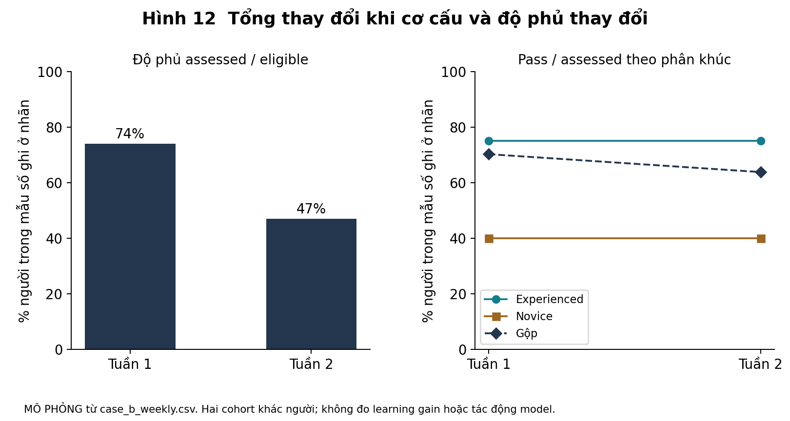

# Đáp án các bài bổ sung

Chỉ mở sau khi hoàn tất bài. Tất cả tình huống mới ở đây là MÔ PHỎNG do giáo trình biên soạn. Các khuyến nghị là ví dụ lập luận chấp nhận được, không là quyết định duy nhất đúng.

## Bài 1D và 5D

Tuần 1: 100 người đủ điều kiện, 320 sessions, 74 assessed và 52 pass. Sessions/người = 3,2; coverage = 74%; pass/assessed = 52/74 = 70,27%. Tuần 2: 100 người, 460 sessions, 47 assessed và 30 pass. Các kết quả tương ứng 4,6; 47%; 63,83%. Sessions tăng 43,75% nhưng pass/assessed giảm khoảng 6,44 điểm phần trăm. Không gọi 6,44 là giảm 6,44%.

Trong segment experienced, pass/assessed là 48/64 = 24/32 = 75%. Segment novice là 4/10 = 6/15 = 40%. Không có giảm ở rate quan sát trong mỗi segment. Tỷ trọng novice trong số assessed tăng từ 10/74 = 13,51% lên 15/47 = 31,91%, kéo tỷ lệ gộp xuống. Đây là ví dụ ảnh hưởng cơ cấu lên tổng, không cần học công thức Simpson để nhận ra. Không gọi đây là đảo chiều Simpson nghiêm ngặt vì hai rate phân nhóm bằng nhau qua tuần, không đảo hướng.

Coverage của experienced giữ 80% ở cả hai tuần, novice từ 50% xuống 25%. Chưa biết missing liên quan năng lực, động lực hay lỗi lịch follow-up. Không có baseline cá nhân và hai cohort khác người, nên chưa thể kết luận learning gain hoặc model mới làm tốt/xấu. Tỷ lệ 52/100 và 30/100 là thành công đã quan sát trên toàn người đủ điều kiện, không tự là tỷ lệ outcome thật khi chưa đo hết.

Nếu coi pass nhị phân và tất cả người thiếu đều thất bại/thành công, tuần 1 có biên 52%–78%; tuần 2 30%–83%. Biên chồng lấp không chứng minh hai sản phẩm tương đương; nó cho thấy dữ liệu thiếu chưa giải được câu hỏi. Những biên này không là confidence intervals và không sửa selection.

Ba cơ chế còn có thể cùng tồn tại: acquisition đưa novice vào nhiều hơn; follow-up thiếu có hệ thống; chất lượng phản hồi/thiết kế luyện thay đổi nhưng bảng tổng che mất. Kế hoạch hợp lý: kiểm cohort cutoffs và event definitions trước; đối chiếu segment và missing; kiểm release/model versions trên cùng task rubric; quan sát cách người học dùng feedback. Sau đó mới quyết định có cần thử nghiệm đo outcome với baseline và đối chứng.

Chấm 1D: hai điểm tính và nhãn metric; hai điểm phân biệt tổng/phân nhóm; hai điểm missing; hai điểm alternatives; hai điểm next check cùng giới hạn. 5D chấm phương pháp và thứ tự ưu tiên, không bắt buộc nêu cả ba cơ chế nếu bảo vệ được lựa chọn. Không cho đạt nếu nói “model không đổi vì hai tỷ lệ segment bằng nhau”: bảng không đủ sức xác nhận.

Hình đọc từ practice/case_b_weekly.csv. Đường gộp giảm dù hai đường phân khúc giữ nguyên; độ phủ cũng giảm. Chưa suy được tác động của sản phẩm.

## Bài 2D

Một đáp án có thể là dùng 2 giờ kiểm số tác vụ bị ảnh hưởng và mức chấp nhận workaround, dành 30 giờ sửa triệt để và 8 giờ QA/đo lại; hoãn dashboard khi chưa có hợp đồng. Điều kiện là sửa 30 giờ có độ chắc đủ và lỗi thực sự ảnh hưởng công việc quan trọng. 4 phút/tác vụ không thể nhân ngay với 60 rồi gọi đó là số người mất 4 giờ: cần biết bao nhiêu tác vụ cần workaround và tần suất thật.

Một đáp án khác có thể dùng workaround có hướng dẫn trong tuần, dành một spike nhỏ cho dashboard và chưa hứa build đầy đủ. Nó chỉ vững khi customer xác nhận workaround chấp nhận được, rủi ro export thấp và có cơ hội thương mại cụ thể. Hãy chấm nhất quán ngân sách, owner, deadline và điều kiện đổi ý, không ép ưu tiên fix trong mọi tình huống.

Điểm 0 nếu tổng giờ vượt 40 mà không giảm scope; 1 nếu nói “ưu tiên theo tác động” nhưng không có cách kiểm; 2 ở chiều hành động khi phân bổ khả thi, ghi phần chưa chắc và đặt thời điểm review.

## Bài 3D

Với churn 10% cuối tháng, đóng góp tích lũy kỳ vọng trên mỗi khách gốc sau 5 tháng là 491.412 đồng; 6 tháng là 562.270,80 đồng; 7 tháng là 626.043,72 đồng. Ngưỡng CAC 600.000 được vượt ở tháng 7. Script verify_learning.py tính bằng tổng từng tháng và đối chiếu công thức cấp số nhân, không gọi dữ liệu mô hình là cash flow đã quan sát.

Vốn chỉ bù 5 tháng đặt ra ràng buộc thanh khoản. Cần biết lịch thu, tốc độ acquisition, chi phí cố định, khả năng trả trước và độ chắc của retention. Không dùng LTV dài hạn dương để bỏ qua thiếu tiền mặt. Có thể giảm acquisition, cải thiện contribution hoặc kiểm paid pilot; lựa chọn cần phù hợp bằng chứng và khả năng vận hành.

Chấm 2 điểm chuỗi survival đúng; 2 điểm đơn vị/cohort; 2 điểm kết quả 5/6/7 tháng; 2 điểm cash constraint; 2 điểm giả định/đề nghị kiểm. Nếu làm tròn tháng quá sớm gây sai, yêu cầu giữ precision ở bước tính rồi làm tròn khi trình bày.

## Bài 4D

Problem statement nên mô tả người quản lý cần chia sẻ thông tin tồn kho đúng người/đúng lúc để phối hợp, effort 20 phút mới là tự thuật của một người. Phương án không AI có thể là mẫu báo cáo và export theo role; phương án người duyệt có thể là tạo draft theo danh sách người nhận được xác nhận rồi quản lý kiểm trước gửi. Chưa đủ bằng chứng để cho hệ thống tự gửi mọi dòng cho mọi đối tác.

Cần kiểm quyền xem dữ liệu, sai sót có thể xảy ra và frequency thực. So với sửa nhãn UI, gửi dữ liệu ra ngoài có hậu quả khó đảo ngược. 10/10 có thể là đề nghị pilot hẹp hoặc không tự động hóa bước gửi, miễn vẫn giải vấn đề và giải thích trade-off. Không chấm theo việc có dùng AI.

## Bài 6D

S01 có lời kể chờ trưởng nhóm, nhưng nhân vật suy “AI nhanh hơn” chưa chứng minh toàn cycle time giảm. Probe: lần gần nhất nhận câu hỏi gì; từ draft đến approval mất bao lâu; ai kiểm policy; có lần duyệt nhanh vì sao? S03 có lo lộ dữ liệu trong kịch bản, chưa có sự cố đã xác minh. Cần hỏi sự kiện cụ thể, quy tắc chia sẻ và tài liệu được phép dùng, không gán “đã xảy ra leak”.

Annotation tốt giữ nguyên câu gốc và ghi lớp diễn giải riêng. Có thể dùng consent để xem ví dụ đã ẩn dữ liệu; từ chối không chứng minh pain yếu. Trừ điểm khi probe chứa sẵn “AI làm bạn chậm” hoặc “bạn cần agent chứ”.

## Bài 7D

Một phân nhóm khả thi: người soạn phản hồi cần trích policy còn hiệu lực trước approval; người trả lời câu hỏi lặp, ít ngoại lệ, template đã đủ. Đây là tiêu chí theo task và quyền, không theo tên nghề. S04 thiếu ngữ cảnh của “đỡ nhiều” nên chưa biết thuộc nhóm nào; phải giữ unknown.

S06 làm yếu mệnh đề mọi task hỗ trợ cần AI, không bác mệnh đề một số task nhiều ngoại lệ cần trợ giúp mới. S02 cho thấy việc kiểm policy có thể giải được bằng search hiện có ở một bối cảnh, chưa chứng minh search đủ cho mọi loại case. Không chia 3/6 thành 50% thị trường.

## Lab T1 và Bài 8D

Codebook mẫu cho phép nhiều code trên một episode. Đây là một cách phân tích được, không là ground truth duy nhất.

| Code | Include | Exclude |
| --- | --- | --- |
| APPROVAL_DELAY | Có bước chờ phê duyệt trong episode | Chỉ nói app chậm, chưa biết bước |
| POLICY_CHECK | Cần kiểm căn cứ policy/phiên bản trước trả lời | Mọi từ “tin tưởng” không có nội dung policy |
| DATA_BOUNDARY | Ràng buộc dùng/chia sẻ dữ liệu được nêu | Lo chung không rõ dữ liệu gì phải ghi unknown |
| INCUMBENT_SUFFICIENT | Nhân vật nêu workflow hiện tại đáp ứng task trong episode | Chỉ thích tính năng chưa có hành vi |
| GOAL_UNCLEAR | Không đủ biết task/outcome của câu khen/chê | Không tự gán là thất bại hoặc không có nhu cầu |

| ID | Gán mã mẫu | Suy luận được phép và giới hạn |
| --- | --- | --- |
| S01 | APPROVAL_DELAY; POLICY_CHECK | Tự thuật gợi bottleneck approval; chưa biết AI rút tổng thời gian |
| S02 | POLICY_CHECK; INCUMBENT_SUFFICIENT | Search policy được kể là đủ trong task này; chưa có thời gian đo độc lập |
| S03 | DATA_BOUNDARY | Ràng buộc tenant data; không có leak thực được quan sát |
| S04 | GOAL_UNCLEAR | Lời khen chung; chưa thể tính hiệu quả |
| S05 | POLICY_CHECK | Kịch bản quan sát câu trả lời dẫn policy cũ; lỗi có thể từ retrieval/version, chưa rõ nguyên nhân |
| S06 | INCUMBENT_SUFFICIENT | Task lặp đã giải bằng template; không đồng nghĩa ngoại lệ phức tạp cũng vậy |

Theme mẫu 1: trong task cần policy và phê duyệt, tốc độ tạo draft chưa đủ quyết định giá trị; khả năng kiểm căn cứ có thể là điều kiện để giảm cycle time. S01/S05 hỗ trợ, S02 giới hạn vì công cụ hiện tại có thể đã đáp ứng. Theme mẫu 2: nên phân biệt task lặp có template đủ dùng với task có ngoại lệ trước khi chọn tự động hóa; S06 là countercase của mệnh đề “AI cho mọi task”, S04 chưa đủ phân nhóm.

Memo mẫu có thể chọn pilot khả năng tìm/trích policy trong một workflow có người duyệt, thay vì tự gửi. Đề nghị kiểm same-task với search hiện có, đo tổng thời gian gồm approval, correctness policy và effort; chốt quyền dữ liệu với người phụ trách trước. Nếu search hiện có đủ tốt, chọn hướng cải thiện discoverability. Nếu còn lỗi policy với hậu quả rõ dù retrieval đúng, cần xem generation/rubric tiếp. Chưa thể ước lượng market size, ROI hoặc tỷ lệ leak từ sáu đoạn giả lập.

Rubric T1: đúng lớp nguồn 0–2; code có include/exclude và locator 0–2; giữ countercases 0–2; theme có điều kiện 0–2; quyết định cùng phép kiểm/điều kiện đổi 0–2. Bài 8D không cần đổi theme chỉ để chứng minh “có học”; cần giải thích phản chứng đã được chứa trong điều kiện hay buộc thu hẹp phạm vi.

## Anchor rubric cho bài gốc

Bài cuối Tập I dùng năm chiều 0–2 như bản gốc. 0 là sai/không có; 1 là có nhưng chung; 2 là cụ thể và có locator/đơn vị/điều kiện. Đúng con số nhưng nhầm đơn vị người chỉ được 0 ở chiều mẫu số.

Bài cuối Tập II dùng năm chiều 0–4. 0 thiếu hoặc đảo nghĩa; 1 nhắc tên phương pháp nhưng không nối quyết định; 2 có thiết kế hợp lý nhưng thiếu denominator/unknown/điều kiện; 3 đủ thành phần, nhất quán; 4 thêm phép kiểm phân biệt và chỉ ra khi nào thiết kế không áp dụng. Không đòi một chữ khuyến nghị cố định. Mức đạt nền tảng vẫn là 16/20 và không có lỗi nghiêm trọng.
