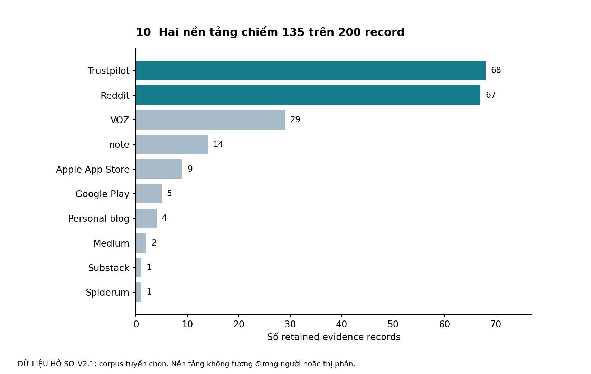

# Case học tập độc lập về English AI

## Quyết định cần làm

Tại snapshot 17/10/2026, câu hỏi phù hợp là nên đầu tư bước nghiên cứu nào để kiểm một nhu cầu còn chưa được phục vụ tốt. Chưa có căn cứ từ corpus để khẳng định app mới tốt hơn AI đa năng, hay PM/DA Việt Nam là segment đã xác nhận. Đây là kết luận phân tích về mức sẵn sàng quyết định, không kết luận thị trường không có cơ hội.

## Điều đã kiểm trực tiếp trong lượt biên soạn

Workbook V2.1 có 200 Evidence ID duy nhất, 149 English-confirmed records, 107 English active AI, 5 English former AI, 37 English unknown AI status và 101 Source ID có record retained. Reddit 67 và Trustpilot 68, tổng 135/200 = 67,5%. Tỷ lệ và missingness tính lại từ các ô raw; lớp review có 23 quote_verified. Mã tái lập và CSV ở practice.

| Snapshot | Record | English | English active AI | Vai trò |
| --- | --- | --- | --- | --- |
| Gốc | 130 | 79 | 42 | Lịch sử |
| Batch4 | 190 | 139 | 98 | Lịch sử, chồng lấp bản hiện hành |
| V2.1 trong workbook tên V2 | 200 | 149 | 107 | Snapshot dùng để giảng dạy |

Không cộng ba dòng thành tổng mẫu. Đơn vị account–thread/review khác cá nhân, episode hoặc nguồn. Một Source ID có thể chứa nhiều người; một account có thể có nhiều record. Cặp E133/E200 đã được hồ sơ xác định cùng account ở hai thread, chưa có identity resolution đầy đủ ngoài cặp này.

Hình từ dữ liệu workbook, đơn vị record. Tập trung nguồn khiến cách tìm kiếm và văn hóa nền tảng có thể ảnh hưởng mẫu hình; không có số population để weight corpus thành thị trường. Không diễn giải số lớn là thị phần.

## Điều các tài liệu báo cáo nhưng chưa xác minh lại độc lập

E166 kể vẫn lặp lỗi sau AI sửa; E172 kể tự gom lỗi và làm đúng 5/5 câu gần mẫu. Chúng giúp tạo câu hỏi về recurrence và practice, chưa chứng minh delayed novel transfer. E198 kể ngừng ELSA vì mức sửa quá chi tiết; E199 kể được lợi và duy trì học; E200 giữ GPT nhưng không có learning gain đo được [P3–P4]. Các ví dụ là self-report trong hồ sơ; giáo trình không quan sát các tác giả ấy thực hiện.

T01/T02 trong benchmark là hai public tasks n=1 do hồ sơ dự án ghi, khác input và job. Chúng không là head-to-head và không có delayed outcome. T03–T05 là planned. Tài liệu tính năng F23/F24 không xác nhận availability hoặc learning efficacy cho mọi account. Giáo trình không đăng nhập, kết nối lịch hay chạy lại tác vụ người dùng [P7].

## Phân biệt các giả thuyết

| ID | Mệnh đề cần giữ đúng scope | Bước học hợp lý |
| --- | --- | --- |
| H1 | Có tự thuật khó chuyển giao, job khác nhau | Thu hẹp job và đo task mới |
| H2 | Claim tuyệt đối thiếu cấu trúc có phản chứng | Kiểm discoverability/setup và duy trì |
| H3 | Có recurrence được kể, thiếu chuỗi cùng lỗi | Kiểm error identity, opportunities và độ trễ |
| H4 | Có nhu cầu English công việc, underserved chưa xác lập | Comparator sau cấu hình và effort |
| H5 | Chưa biết churn chủ yếu vì lack-progress | Cohort/timeline và alternative causes |
| H6 | Chưa biết app riêng vượt tool đa năng | So sánh đúng job, điều kiện và outcome |

Không có căn cứ nâng H5/H6 thành được xác nhận bằng ba record mới. Pain và counterevidence cần được giữ cạnh nhau. Mỗi mệnh đề muốn kết luận mạnh hơn cần loại evidence mới, không chỉ thêm complaint cùng dạng [P5].

## Hai nghiên cứu tiếp được thiết kế trong hồ sơ

P1 dự kiến sáu người đi làm, gồm bốn pain và hai success, kiểm tự dùng lại sau feedback. Protocol dùng baseline, workflow tự dùng, configured comparator, học cùng thời gian và bài mới không hint sau 48 giờ/bảy ngày. Tách speaking/writing; kiểm feedback đúng trước khi gọi retrieval failure. Opportunities là mẫu số cho correct use, đồng thời báo participant/task coverage [P10].

P2 dự kiến bốn người IELTS Writing có quyết định ôn/thi gần, gồm ba uncertain và một satisfied. Cùng essay và rubric, ba run cùng model/settings và hai rater độc lập; theo dõi priorities, uncertainty và decision/cost episode. Đồng thuận band không tự là điểm thi chính thức. P2 không đo learning gain dài hạn và không gộp vào P1.

Đây là protocol chưa triển khai; không có người đã tuyển, rater đã thuê hoặc kết quả follow-up. Ngưỡng 80% của P1 là vận hành chốt trước, không chuẩn CEFR và không kết quả. Primary plan gốc P9 có O1–O3 khác quota; không trộn vào P10 hiện hành.

## Decision brief mẫu

SUY LUẬN VÀ ĐỀ XUẤT. Giữ quyết định ở mức chuẩn bị và kiểm protocol P1/P2; chưa đầu tư build app. A app chuyên biệt chưa chứng minh incremental outcome; B workflow hiện có có thể đủ nếu friction thiết lập được giải; C human/hybrid cần kiểm phần nào đòi hỏi chuyên môn và chi phí; D nghiên cứu thêm giảm được bất định quan trọng về residual gap. D phù hợp lúc này, nhưng phải có gate và thời hạn.

Nếu configured incumbent đạt outcome, giữ nghĩa, tự duy trì và effort được chấp nhận theo gate chốt trước, làm yếu underserved claim trong nhóm đã tuyển. Nếu gap còn với consequence thật, tiếp tục nghiên cứu mechanism/value, không tự chuyển thành launch. Nếu thiếu delayed data hoặc task không tạo opportunities, báo chưa rõ và sửa thiết kế. Không tăng confidence chỉ vì số record tăng.

## Bài tập case

1. Sửa câu 23 người đã được xác minh có vấn đề thật thành câu đúng đơn vị và loại evidence.
2. Đề xuất hai alternative explanations cho E166 và artifact cần để phân biệt.
3. Chọn một job để benchmark; viết output metric, task metric và learning metric riêng.
4. Chỉ ra giả thuyết có thể bị feature documentation làm yếu và giả thuyết cần delayed behavioral task.
5. Viết brief chọn A–D, giữ một điều có thể làm đổi ý.

## Gợi ý đáp án

1. Lớp review đánh dấu 23 record có original quote đã đối chiếu; không xác nhận 23 cá nhân độc lập hoặc learning outcomes. 2. Feedback sai cần rater xem bài gốc/correction; task mismatch cần cùng trọng tâm, cơ hội và modality trong task mới. 3. Với job tự viết risk email: output là sửa đúng giữ mức cam kết; task là hoàn thành email; learning là tự dùng ở bài mới trễ không hint. 4. Claim không có tính năng có thể bị documentation phản bác ở mức được mô tả; superiority/transfer cần so outcome theo thiết kế phù hợp. 5. Có nhiều lựa chọn hợp lý nếu mức cam kết tương xứng bằng chứng và có revise rule; build toàn diện dựa trên counts không đạt.

## Giới hạn case

Không có prevalence thị trường, RCT, giá thị trường cập nhật, pricing validation hay bằng chứng ứng dụng mới cải thiện học. Không có phỏng vấn mới để báo. Các nguồn gốc người dùng chưa được tái kiểm toàn corpus. Phần event analytics capstone sẽ là MÔ PHỎNG ở Tập V và không được cộng vào evidence thật. Case này hoàn thành phần audit và decision reasoning của snapshot, không thay toàn bộ capstone nâng cao.
