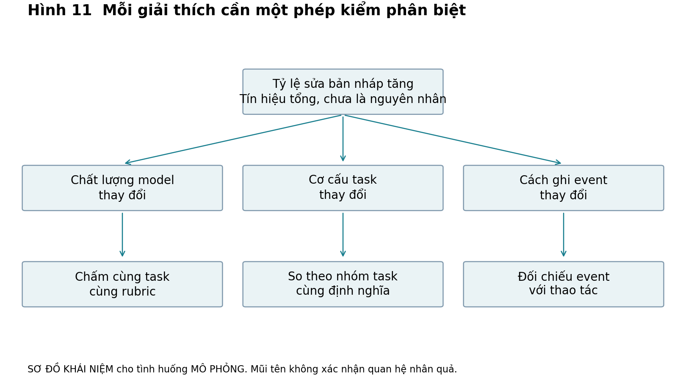

# Bổ sung biên tập Tập I

## ADD1

## Theo dõi sản phẩm đã phát hành

Khi sản phẩm đã có người dùng, PM vẫn cần hỏi giá trị đang thay đổi ở đâu. Một mô hình AI có thể sửa câu đúng hơn nhưng người học bỏ qua bản sửa vì quá dài. Người học có thể chấp nhận bản sửa và gửi email nhanh hơn mà vẫn chưa tự viết được. Họ cũng có thể học tốt nhưng không trả tiền vì công ty đã mua một công cụ khác. Mỗi bước cần bằng chứng riêng.

Hãy dùng năm lớp: chất lượng đầu ra mô hình; thành công tác vụ ngay; trải nghiệm sử dụng; kết quả dài hạn của người dùng; tác động kinh doanh. Tỷ lệ correction giữ đúng ý thuộc lớp đầu. Email gửi được đúng hạn thuộc lớp thứ hai. Thời gian chờ và mức dễ hiểu thuộc trải nghiệm. Bài mới không trợ giúp sau một khoảng trễ thuộc kết quả học. Khoản đóng góp sau chi phí phục vụ thuộc kinh doanh. Không có phép đổi tự động từ lớp này sang lớp khác.

MÔ PHỎNG WORKED EXAMPLE. Công cụ hỗ trợ viết có 100 tác vụ: 90 phản hồi được rater chấm giữ đúng ý; 70 tác vụ được người dùng hoàn tất; 50 người tự báo dễ dùng. Ba mẫu số cần được kiểm: 100 tác vụ được chấm không nhất thiết đến từ 100 người; 50 phản hồi khảo sát cần số người được mời; 70 hoàn tất có thể gồm bản người dùng tự sửa. Vì vậy không thể viết “90% khách hài lòng và học hiệu quả”. Quyết định trước mắt là kiểm user/task IDs và độ phủ khảo sát, rồi chọn phép đo đúng mục tiêu. Lựa chọn này do PM và DA phối hợp; engineer kiểm event nào thực sự được ghi.

### Bài 1D áp dụng vào case chưa có lời giải

Case B MÔ PHỎNG nằm trong practice/case_b_weekly.csv. Hai hàng mỗi tuần là hai phân khúc của một cohort 100 người mới đủ điều kiện; cohort tuần 1 và tuần 2 khác người. Mỗi người có thể có nhiều session. Người assessed đã làm đúng một bài mới không trợ giúp sau bảy ngày; pass là đạt rubric giả lập. Cửa sổ của cả hai cohort đã đủ bảy ngày. Segment được xác định trước khi dùng sản phẩm, nhưng dữ liệu không chứa baseline năng lực cá nhân.

Tính sessions/người đủ điều kiện, độ phủ đánh giá và pass/assessed cho từng tuần lẫn từng segment. Viết ba cách giải thích cho việc engagement tăng nhưng tỷ lệ pass toàn nhóm giảm. Dữ liệu nào giúp phân biệt chúng? Nộp bảng tính tay và memo 200 từ trước khi mở instructor. Không được gọi số mô phỏng là kết quả dự án English AI thật.

## ADD2

## Từ giả thuyết cạnh tranh đến một phép kiểm hữu ích

MÔ PHỎNG. Một ứng dụng trợ lý hỗ trợ khách hàng có tỷ lệ nhân viên sửa lại câu trả lời tăng từ 10% lên 18% sau bản phát hành. Đội muốn quay về model cũ. Nhưng cùng lúc, sản phẩm mở cho nhóm câu hỏi khó hơn và đổi nút “sửa” thành dễ thấy hơn. Từ một tỷ lệ tổng, chưa biết model kém đi, cơ cấu task đổi hay cách ghi nhận đổi.

| Giải thích | Dấu hiệu có thể phân biệt | Nếu thấy dấu hiệu thì được nói gì |
| --- | --- | --- |
| Model mới làm sai hơn | Chấm mù hai cấu hình trên cùng bộ task, cùng rubric và điều kiện | Khác biệt trên testset; chưa là tác động lên toàn khách hàng |
| Task mix khó hơn | Tỷ lệ sửa theo loại task trước/sau, cùng định nghĩa | Có hoặc chưa có thay đổi trong từng nhóm; chưa đủ loại confounding |
| Instrumentation đổi | So event mới với trace và thao tác được ghi của cùng task | Một phần biến động có thể do phép đo; chưa biết chất lượng model |

Kiểm đầu tiên nên vừa đủ để thay đổi hành động. Nếu chỉ cần 2 giờ để engineer xác nhận nút mới phát event hai lần, hãy kiểm trước khi dành hai tuần chấm model. Nếu đã có một lỗi nặng tái hiện được, giảm phơi nhiễm lỗi ấy có thể cần làm ngay, đồng thời điều tra phần còn lại. Không dùng “còn bất định” để trì hoãn một biện pháp hạn chế thiệt hại rõ.

Hình 11 là sơ đồ khái niệm của tình huống mô phỏng, nối mỗi cách giải thích với một loại kiểm tra. Một phép kiểm có thể chỉ loại một phần bất định; mũi tên không chứng minh nguyên nhân.

## Một decision memo hoàn chỉnh

MÔ PHỎNG do giáo trình thiết kế, không là sự cố thật. Quyết định lúc 10 giờ thứ Hai: phân bổ 40 giờ kỹ thuật tuần này giữa xử lý lỗi xuất báo cáo và làm dashboard mới. 12 trong 60 tác vụ export hôm qua thất bại theo log; chưa biết số người bị ảnh hưởng vì thiếu user join. Nhân viên hỗ trợ tái hiện được lỗi trên một mẫu file. Khách lớn đề nghị dashboard nhưng chưa có cam kết hợp đồng.

Khuyến nghị: dùng 8 giờ đầu để khoanh vùng và sửa lỗi export, thêm 4 giờ kiểm hồi quy/đo lặp; giữ 28 giờ còn lại chưa cam kết. Phương án B dùng cả 40 giờ cho dashboard có lợi ích thương mại chưa xác nhận và để lỗi đang chặn tác vụ tiếp diễn. Phương án C chỉ nghiên cứu thêm không giải quyết lỗi đã tái hiện. Một bản vá giới hạn có thể đảo ngược nếu QA không đạt; hợp đồng giao dashboard là cam kết khác, cần sponsor duyệt.

Owner kỹ thuật xác nhận phạm vi sửa trước 14 giờ; DA kiểm số tác vụ và người ảnh hưởng; PM cập nhật khách qua kênh đã được ủy quyền, không hứa ngày giao chưa thống nhất. Kiểm lại lúc 16 giờ thứ Ba bằng tỷ lệ export thành công trên file hợp lệ, tách từng loại file. Đây là tiêu chí vận hành do đội giả lập đề xuất, không benchmark ngành. Nếu sửa cần hơn 12 giờ hoặc tác động tới toàn pipeline, dừng phương án vá hiện tại để review với engineering lead; nếu dashboard có hợp đồng chắc và một workaround export chấp nhận được, mở lại phân bổ.

Memo tốt không cần chắc chắn mọi chuyện. Nó làm rõ điều đang được quyết, nguồn biết, chi phí của lựa chọn bị bỏ, ai làm gì và khi nào cần đổi. Các số trong memo là dữ liệu tình huống mô phỏng; dự báo lợi ích dashboard vẫn là giả thuyết.

### Bài 2D phản biện quyết định

MÔ PHỎNG. Lúc 14 giờ, engineer báo lỗi export cần 30 giờ mới sửa triệt để; workaround là xuất CSV mất thêm 4 phút/tác vụ. Khách lớn cần dashboard vào thứ Sáu nhưng hợp đồng chỉ được duyệt tuần sau. Viết lại memo, giữ tổng capacity 40 giờ. Nêu ít nhất hai lựa chọn khả thi, một phép kiểm trong 2 giờ và một điều kiện khiến bạn đổi khuyến nghị. Không được giữ nguyên 8 giờ chỉ vì đó là số ví dụ ban đầu.

## ADD3

## Đóng góp và lợi nhuận gộp cần định nghĩa riêng

Trong ví dụ 100 tài khoản, 80.000 đồng được giả định vừa là chi phí phục vụ được xếp vào giá vốn, vừa là toàn bộ chi phí biến đổi mỗi tài khoản. Vì vậy gross profit trên tài khoản và contribution cùng bằng 120.000 đồng ở ví dụ đó. Ngoài giả định này chúng có thể khác: hoa hồng thanh toán hoặc bán hàng có thể là chi phí biến đổi nhưng được phân loại khác trong báo cáo; giá vốn có thể gồm phần cố định. Khi làm việc thật, chốt định nghĩa với Finance rồi giữ nhất quán. Không dùng nhãn “trực tiếp” để tự xác định mọi khoản là biến đổi.

## Vì sao hoàn vốn năm tháng có thể thành sáu tháng

Trực giác: một khách còn trả tiền tạo 120.000 đồng đóng góp mỗi tháng. Nếu ai cũng ở lại đủ năm tháng, tổng là 600.000 đồng và bù CAC. Nhưng khi một số người rời, nhóm khách ban đầu tạo ít đóng góp hơn ở những tháng sau. Phải tính trên cùng cohort gốc, không chỉ trên người sống sót.

MÔ PHỎNG. Mọi khách trả ở đầu tháng thứ nhất; churn xảy ra cuối mỗi tháng; xác suất rời cố định 5%; không tái kích hoạt, không chiết khấu, không phí bổ sung. Tỷ lệ còn trả ở tháng 1 là 1; tháng 2 là 0,95; tháng 3 là 0,95 × 0,95 = 0,9025. Đóng góp kỳ vọng tháng t trên mỗi khách ban đầu bằng 120.000 × 0,95^(t−1).

Tổng năm tháng là 120.000 × (1 + 0,95 + 0,95² + 0,95³ + 0,95⁴) = 542.925,75 đồng. Tổng sáu tháng là 635.779,46 đồng. Vì vậy ngưỡng 600.000 đồng được vượt ở tháng 6 trong mô hình cohort này. Đây không phải khẳng định từng khách hoàn vốn sau sáu tháng; một số rời trước đó. Tỷ số CAC/m = 5 là thời gian hoàn vốn đơn giản khi bỏ qua mất khách, không phải expected cohort payback có churn.

Nếu kéo dài vô hạn với churn c trong khoảng 0 < c ≤ 1 và đóng góp m cố định, tổng m × [1 + (1−c) + (1−c)² + …] bằng m/c. Cách đếm này cho khách trả tháng đầu trước khi có thể rời. Đổi thời điểm thu, thêm discount hoặc costs sẽ đổi mô hình. Khi c = 0, phép chia m/c không xác định; dùng thời hạn hữu hạn phù hợp thay vì báo LTV vô hạn như dự báo.

MÔ PHỎNG TRADE-OFF. Một nhóm đang cân nhắc thêm voice làm đóng góp mỗi tháng giảm một nửa. Nếu churn giữ nguyên, lợi ích kinh tế dài hạn cũng giảm một nửa trong mô hình. Nhưng voice có thể thay đổi retention, acquisition hoặc pricing. Không thể chỉ nhân đôi thời gian hoàn vốn rồi kết luận phải bỏ voice; cần đo các biến có khả năng đổi quyết định và đặt giới hạn ngân sách thử.

### Bài 3D từ công thức sang quyết định

MÔ PHỎNG. CAC 600.000 đồng; contribution 120.000/tháng; churn cuối tháng 10%. Tính đóng góp kỳ vọng tích lũy sau 5, 6 và 7 tháng bằng cộng từng tháng. Tháng nào vượt CAC? Nếu chỉ có vốn bù CAC trong 5 tháng, cần làm rõ điều gì trước khi tăng acquisition? Dùng practice/payback_inputs.csv; có thể làm bằng máy tính thường. Lời giải Python ở instructor, không cần cài thư viện ngoài.

## ADD4

## Khi cơ hội nhỏ cần một quyết định nhanh

MÔ PHỎNG. Phần mềm quản lý kho có nút xuất danh sách đặt ở vị trí khó thấy. Bốn trong năm người tham gia usability đã được tuyển có chủ đích không tìm được nút trong tác vụ. Một thay đổi nhãn mất một giờ, có thể khôi phục, không đổi dữ liệu xuất. Đây là bằng chứng hẹp về khả năng tìm thấy nút, không phải market validation. Dù vậy, vì can thiệp rẻ và đảo ngược được, đội có thể sửa nhãn sau review thiết kế và theo dõi task completion.

Lý do không phải “bốn trong năm nghĩa là 80% thị trường cần”. Lý do là lỗi thao tác đã quan sát, lời giải có cơ chế hợp lý, chi phí và hậu quả được giới hạn. Nếu thay đổi ảnh hưởng quy trình làm việc của hàng nghìn người, bài toán sẽ khác: cần kiểm người đang quen vị trí cũ, hỗ trợ rollout và xem có tăng thao tác nhầm hay không.

### Bài 4D áp dụng độc lập

MÔ PHỎNG. Khách hàng doanh nghiệp đề nghị tự động gửi báo cáo kho cho mọi đối tác mỗi tối. Phỏng vấn mới cho biết một quản lý mất 20 phút chuẩn bị báo cáo, chưa biết đối tác nào được quyền xem từng dòng. Viết problem statement, một phương án không cần AI, một phương án có người duyệt và một việc cần kiểm trước khi tự động gửi. Phân biệt rõ sửa nhãn ở ví dụ với cấp quyền gửi dữ liệu ra ngoài ở bài này. Nộp khuyến nghị tối đa 250 từ; không cần kiến thức RAG hay agent để làm bài.
